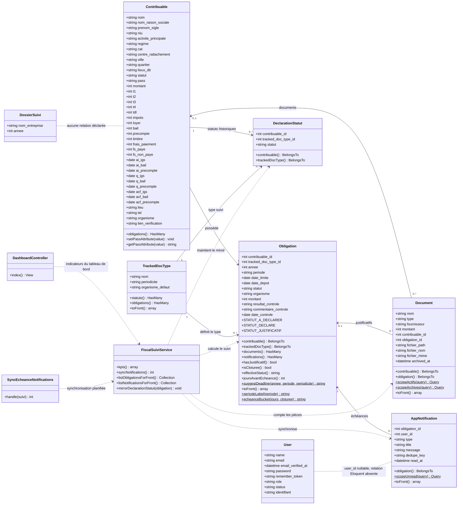

# Diagramme de classes FiscalTrack

Ce diagramme représente les classes métier Laravel d'après les modèles, services et migrations présents dans le projet. Les attributs `id`, `created_at` et `updated_at` sont hérités ou générés par Eloquent et les migrations; ils ne sont pas répétés dans chaque classe.

## Précisions sur le modèle

- `Contribuable` contient des données d'identification, de contact, de régime fiscal et de suivi de montants/dates. `pass` est chiffré par les accesseurs du modèle.
- `Obligation` est l'entité centrale du suivi par contribuable, type de document, année et période. Son statut effectif et ses échéances sont calculés par ses méthodes.
- `DeclarationStatut` sert de miroir de compatibilité pour l'ancienne matrice de statuts; `FiscalSuiviService::mirrorDeclarationStatut()` l'actualise depuis une obligation.
- `Document` peut être associé à un contribuable et/ou à une obligation. `archived_at` distingue les documents archivés des documents actifs.
- La table `app_notifications` possède un champ nullable `user_id`, mais `AppNotification` ne déclare pas de relation Eloquent vers `User` et la migration ne pose pas de clé étrangère correspondante. Le lien en pointillés signale cette limite du code actuel.
- `DossierSuivi` possède une table et un modèle, mais aucune relation ni méthode métier n'est déclarée dans le modèle actuel.
- `User` hérite des fonctions d'authentification Laravel; seules ses propriétés applicatives sont listées ici.