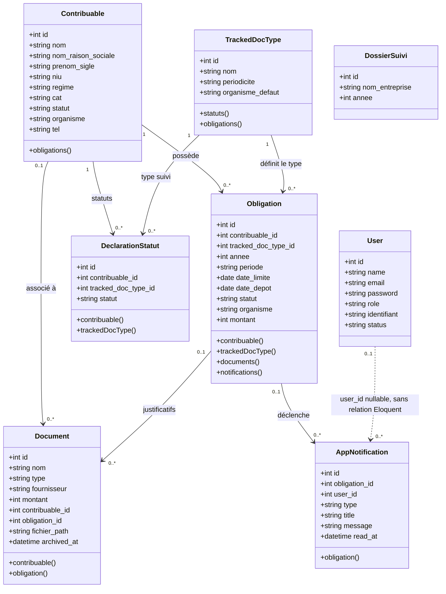

# Diagramme de classes FiscalTrack

Le diagramme ci-dessous représente les principales classes métier et les relations déclarées dans les modèles Eloquent et les migrations.

## Remarques sur le modèle actuel

- `DeclarationStatut` associe un contribuable à un type de document suivi. La base impose un seul statut par couple contribuable/type.
- Une obligation est unique pour un contribuable, un type, une année et une période.
- `Document.contribuable_id` et `Document.obligation_id` sont nullable; ils peuvent être absents.
- `AppNotification.user_id` existe en base, mais aucune clé étrangère ni relation Eloquent vers `User` n'est définie.
- `DossierSuivi` n'a actuellement aucune relation déclarée avec les autres classes.
- Les attributs affichés sont les principaux attributs métier; les champs d'horodatage Laravel (`created_at`, `updated_at`) sont omis pour garder le schéma lisible.